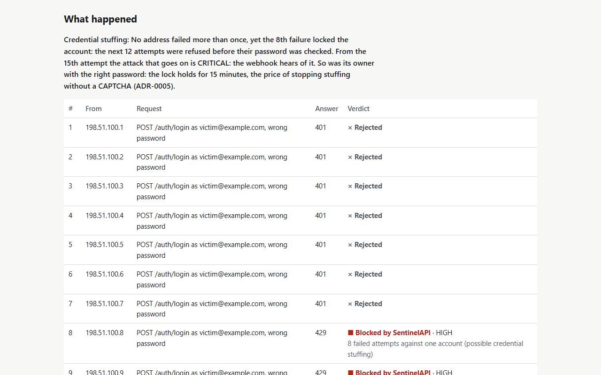
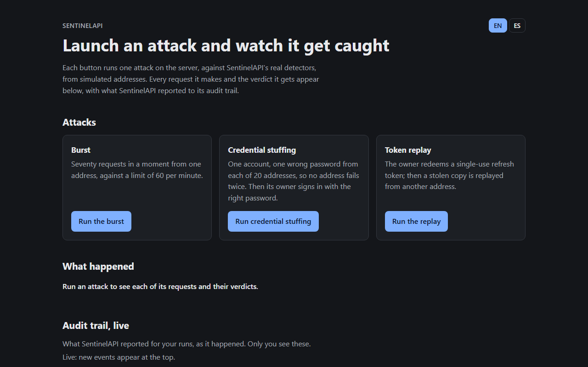
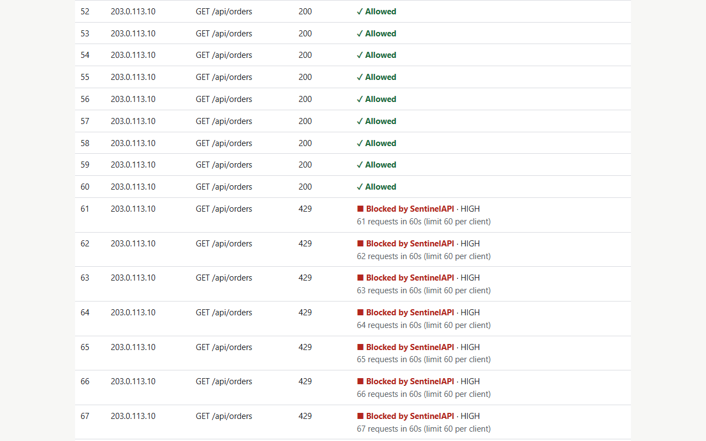
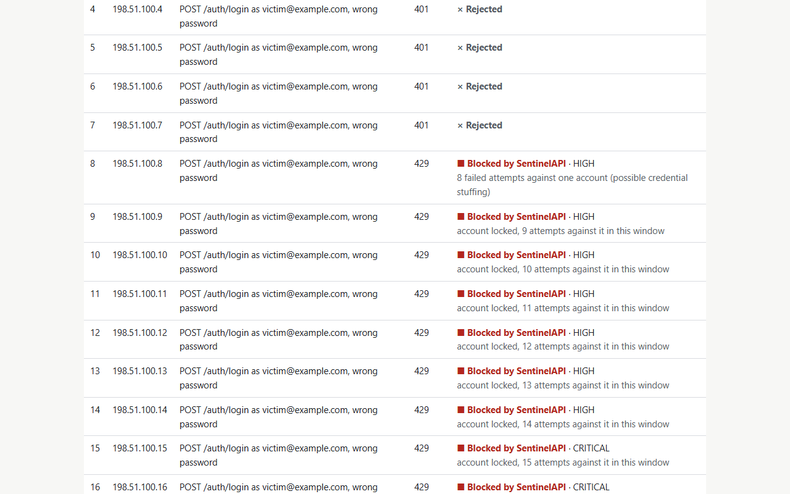
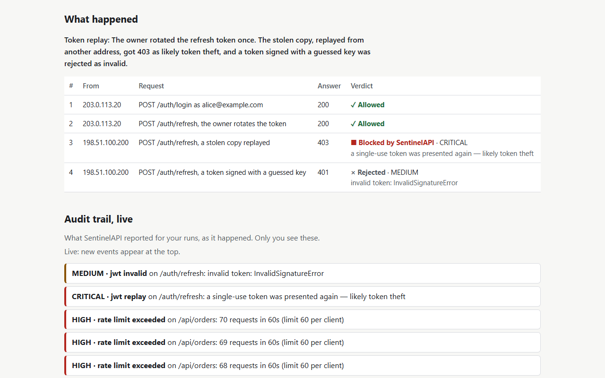

# SentinelAPI

**Threat-detection middleware for FastAPI.** Add it to an existing app and get fixed-window rate limiting, brute-force detection that also catches credential stuffing, and single-use refresh tokens. Every verdict goes to a private, queryable audit trail.

[](https://sentinelaapi.duckdns.org)
[](https://pypi.org/project/fastapi-sentinel/)
[](https://github.com/Alesso2805/sentinelapi/actions/workflows/ci.yml)
[](https://docs.python.org/3/)
[](https://fastapi.tiangolo.com/)
[](https://docs.sqlalchemy.org/)
[](https://redis.io/docs/latest/)
[](https://docs.docker.com/compose/)
[](https://mypy.readthedocs.io/)
[](LICENSE)



> **Status:** 1.0.0, [on PyPI as `fastapi-sentinel`](https://pypi.org/project/fastapi-sentinel/), with the demo live at **[sentinelaapi.duckdns.org](https://sentinelaapi.duckdns.org)**. See the [changelog](CHANGELOG.md).

## What it catches

| Attack | How SentinelAPI catches it | What the attacker gets |
| --- | --- | --- |
| A flood from one client | It counts the client's requests in a fixed window, whatever the path or the User-Agent, with stricter limits on prefixes such as `/auth/` | 429 with `Retry-After` from the first request over the limit |
| Password guessing from one address | It counts failed logins per source, and checks before the password | 429 for every login from that source until the window ends, the right password included |
| Credential stuffing: one account, a new address every time | It counts failed logins per account, from any source, after trimming and casefolding the username | `lock` (the default): 429 for that account from every source until the window ends. `signal`: your app gets `challenge_required`, to ask for a CAPTCHA or MFA |
| A stolen refresh token used again | It remembers each single-use token's `jti` until the token expires, on the paths you name | 403 for the second use, from any address |

Every verdict, blocking or not, is logged with its request's id. It also goes to an audit trail where addresses and usernames appear only as keyed hashes, and CRITICAL ones go to a webhook if you set one. With `SENTINEL_ENFORCE=false`, SentinelAPI records everything and blocks nothing, so you can watch it on real traffic first ([rollout runbook](docs/runbooks/rollout.md)).

## Why this exists

Most "add security" advice for a backend service stops at "put a rate limiter in front of it." A rate limiter alone misses two attacks:

- **Credential stuffing.** An attacker spreads the attempts against *one* account across many addresses, so no address ever crosses a per-IP threshold. To catch it, you have to count failures per **account** as well as per **address**.
- **Token replay.** A stolen refresh token is used again after the real client has rotated it. A signature check does not catch that. You have to treat single-use tokens as actually single-use.

SentinelAPI catches both, and does standard rate limiting too. Each detector is small and tested on its own; there is no monolithic "security module."

## Live demo

**[sentinelaapi.duckdns.org](https://sentinelaapi.duckdns.org)**: each button runs one attack against the real detectors, from simulated addresses:

- a burst over the rate limit;
- credential stuffing from 20 addresses;
- a replayed refresh token.

You see each request with its verdict, and the audit trail as it is written: your own events only, and 10 attacks an hour per visitor. The same console runs locally with `docker compose up --build --wait`, at http://localhost:8000/.

| | |
| --- | --- |
|  |  |
|  |  |

## Use it in your app

```bash
pip install "fastapi-sentinel[sqlite]"     # or [postgres], for the audit trail's database; add redis for several processes
```

The distribution is `fastapi-sentinel`, since PyPI holds `sentinelapi` too close to another project's name; the package you import is `sentinelapi`. Then create the audit table with `sentinel migrate` (it reads `SENTINEL_DATABASE_URL`), and:

```python
from fastapi import FastAPI, HTTPException, Request
from pydantic import BaseModel

from sentinelapi.integration import install_sentinel

app = FastAPI()
sentinel = install_sentinel(app)  # rate limit + replay check on every request, and the audit trail


class Login(BaseModel):
    username: str
    password: str


@app.post("/login")
async def login(body: Login, request: Request) -> dict[str, str]:
    await sentinel.login_guard.check(request, body.username)  # 429 while the source or account is blocked
    if not passwords_match(body.username, body.password):  # your own check
        await sentinel.login_guard.failed(request, body.username)
        raise HTTPException(status_code=401, detail="Invalid credentials")
    await sentinel.login_guard.succeeded(request, body.username)
    return {"token": "..."}
```

Three lines are SentinelAPI's: the import, `install_sentinel(app)`, and the guard around your own password check. Settings come from `SENTINEL_*` variables (see [Configuration](#configuration)). `install_sentinel(app, settings, on_event=...)` also takes them explicitly, and an `on_event` coroutine receives every verdict after the log and the audit trail. This snippet runs as a test, against the source and against the built wheel with each extra, so it cannot drift from the code.

In your own app, run `sentinel migrate` against `SENTINEL_DATABASE_URL` before the app starts, the way you run your own migrations. SentinelAPI's history keeps its own version table, so it never touches yours. On Postgres, `sentinel migrate --app-role <the role your app connects as>` grants that role INSERT and SELECT on the audit table and nothing else, so the trail is append-only. `sentinel purge` deletes events past the retention period.

## Guarantees

Each guarantee below is a test that runs on every pull request, on Python 3.11 to 3.15, and on both Redis and the in-memory backend where it applies. The names are the tests' own; a test checks that every name here exists.

### Rate limiting

| Guarantee | Test |
| --- | --- |
| A client gets exactly its limit. The next request gets 429, and `Retry-After` is what is left of the window | [test_rate_limiter.py](tests/unit/test_rate_limiter.py): `test_the_request_after_the_limit_is_blocked`, `test_retry_after_is_what_is_left_of_the_window` |
| A client under its limit is never blocked, however long it keeps going | [test_rate_limiter.py](tests/unit/test_rate_limiter.py): `test_a_client_under_its_limit_is_never_blocked` |
| A new User-Agent or a new path does not reset the count | [test_rate_limiter.py](tests/unit/test_rate_limiter.py): `test_a_new_user_agent_does_not_reset_the_count`, `test_a_new_path_does_not_open_a_new_counter` |
| Behind your proxy, each client has its own limit. Anyone else's `X-Forwarded-For` is ignored | [test_demo_app.py](tests/integration/test_demo_app.py): `test_clients_behind_a_trusted_proxy_get_their_own_limits`, `test_forwarded_for_from_an_untrusted_peer_is_ignored` |
| Health checks are never rate limited | [test_demo_app.py](tests/integration/test_demo_app.py): `test_health_checks_are_never_rate_limited` |
| Both backends count the same way: a window starts with the first hit and is never extended, and increments are atomic | [test_counter_backends.py](tests/contract/test_counter_backends.py): `test_the_window_starts_with_the_first_hit_and_is_not_extended`, `test_increments_are_atomic_under_concurrency` |

### Brute force and credential stuffing

| Guarantee | Test |
| --- | --- |
| A blocked source is refused even with the right password | [test_demo_app.py](tests/integration/test_demo_app.py): `test_the_right_password_does_not_lift_a_block` |
| Stuffing from many addresses is caught on the account, and the account is refused from every source | [test_brute_force.py](tests/unit/test_brute_force.py): `test_credential_stuffing_from_many_ips_is_caught_by_username_axis`, `test_a_locked_account_is_refused_from_any_source` |
| An attack that goes on against a locked account turns CRITICAL and reaches the webhook once, not once per address | [test_brute_force.py](tests/unit/test_brute_force.py): `test_an_attack_that_goes_on_against_a_locked_account_turns_critical`; [test_alerts_end_to_end.py](tests/integration/test_alerts_end_to_end.py): `test_credential_stuffing_reaches_the_webhook_once` |
| Case and spaces do not split one account | [test_brute_force.py](tests/unit/test_brute_force.py): `test_case_and_spaces_do_not_split_one_account` |
| The owner's login does not erase what other sources tried, and an attacker cannot clear its record by signing into its own account | [test_brute_force.py](tests/unit/test_brute_force.py): `test_the_owners_login_does_not_erase_what_other_sources_tried`, `test_an_attacker_cannot_clear_its_record_with_an_account_of_its_own` |
| Shadow mode shows the verdicts enforcement would give | [test_brute_force.py](tests/unit/test_brute_force.py): `test_in_shadow_mode_an_attempt_counts_once`; [test_demo_app.py](tests/integration/test_demo_app.py): `test_shadow_mode_records_events_but_never_blocks` |

### Single-use tokens

| Guarantee | Test |
| --- | --- |
| A used token is refused for its whole life, from any address | [test_jwt_replay.py](tests/unit/test_jwt_replay.py): `test_a_used_token_is_refused_for_its_whole_life`, `test_replay_from_a_different_fingerprint_is_still_caught` |
| A token without `exp` or `jti` is refused on those paths | [test_jwt_replay.py](tests/unit/test_jwt_replay.py): `test_a_token_without_exp_is_flagged`, `test_token_without_jti_cannot_be_verified_single_use` |
| Hostile paths, headers, tokens, usernames and addresses never crash a detector | [test_hostile_input.py](tests/unit/test_hostile_input.py): `test_rate_limiter`, `test_brute_force`, `test_jwt_replay`, `test_client_address` |

### Audit trail

| Guarantee | Test |
| --- | --- |
| No raw address or username reaches the audit trail | [test_audit_privacy.py](tests/integration/test_audit_privacy.py): `test_no_raw_address_or_username_reaches_the_audit_trail` |
| The app's database role cannot rewrite or delete the trail | [test_audit_migrations.py](tests/integration/test_audit_migrations.py): `test_the_app_role_cannot_rewrite_the_audit_trail` |
| A flood is a couple of rows, not one per request | [test_audit_write_path.py](tests/integration/test_audit_write_path.py): `test_a_flood_from_one_source_is_one_row_per_level`, `test_a_burst_writes_a_couple_of_rows_not_one_per_request` |
| A database outage never fails a request, and its verdicts still hold | [test_audit_write_path.py](tests/integration/test_audit_write_path.py): `test_requests_keep_their_verdicts_when_the_database_is_down` |
| Only the operator reads the events | [test_events_api.py](tests/integration/test_events_api.py): `test_nobody_but_the_operator_reads_the_events` |

### Running it

| Guarantee | Test |
| --- | --- |
| The README's snippet works as written | [test_installer.py](tests/integration/test_installer.py): `test_the_readme_snippet_works_as_written`; from the wheel, [smoke_installed.py](scripts/smoke_installed.py) |
| Streaming responses, background tasks and your app's own lifespan pass through untouched | [test_installer.py](tests/integration/test_installer.py): `test_streaming_responses_and_background_tasks_pass_through`, `test_the_apps_own_lifespan_still_runs` |
| A failing `on_event` never fails the request | [test_installer.py](tests/integration/test_installer.py): `test_a_failing_on_event_never_fails_the_request` |
| Production refuses unsafe settings and names every problem at once | [test_settings.py](tests/unit/test_settings.py): `test_production_refuses_unsafe_settings`, `test_every_problem_is_named_at_once` |
| `/ready` answers 503 until Redis and the migrated database answer | [test_operations.py](tests/integration/test_operations.py): `test_not_ready_when_redis_is_unreachable`, `test_not_ready_when_the_database_is_not_migrated` |
| The detectors import no web framework, database or Redis client | [test_imports.py](tests/architecture/test_imports.py): `test_detectors_import_only_the_standard_library_pyjwt_and_the_domain` |

## Quickstart

### Docker (full stack: API + Redis + Postgres)

```bash
docker compose up --build --wait    # or: make up
curl http://localhost:8000/health
```

Then open http://localhost:8000/ for the attack console.

- A `migrate` service creates the audit table as its owner and exits. The API starts after it and connects as a role that can only add and read audit rows. Only the API's port is published.
- `docker compose run --rm migrate sentinel purge` applies the retention period.
- `/ready` answers 503 until Redis and the migrated database answer.
- Every response carries an `X-Request-ID`, and every log line of that request carries it too (JSON lines in production).

On a server, `deploy/docker-compose.prod.yml` adds the production settings, requires the secrets in `.env` and puts Caddy in front with HTTPS ([deploy runbook](docs/runbooks/deploy.md)).

### Local dev (in-memory backend + SQLite, zero external services)

With [uv](https://docs.astral.sh/uv/), which installs the exact versions of `uv.lock`:

```bash
uv sync --all-extras
uv run sentinel migrate        # creates the audit table (SQLite here)
uv run uvicorn examples.demo_app.main:app --reload
```

Or with pip: `pip install -e ".[demo]"`, then `sentinel migrate` and `uvicorn examples.demo_app.main:app --reload`. `make demo` does both. Set `SENTINEL_DEMO_MODE=true` for the attack console at `/`. The demo's API is in [docs/openapi.json](docs/openapi.json), and at `/docs` while it runs.

Try it:

```bash
# Normal login
curl -X POST localhost:8000/auth/login \
  -H "Content-Type: application/json" \
  -d '{"username":"alice@example.com","password":"correct-horse-battery-staple"}'

# Trigger brute-force detection (run this ~10x with a wrong password)
curl -X POST localhost:8000/auth/login \
  -H "Content-Type: application/json" \
  -d '{"username":"alice@example.com","password":"wrong"}'

# See what SentinelAPI has caught: operators only, with SENTINEL_OPERATOR_TOKEN
# (start the demo with SENTINEL_OPERATOR_TOKEN=dev-operator-token to try this;
# docker compose sets it for you)
curl -H "Authorization: Bearer dev-operator-token" "localhost:8000/security/events?threat_level=high"
```

## Architecture

The detection logic never imports FastAPI, Redis or SQLAlchemy. It depends on a `CounterBackend` protocol and returns plain `SecurityEvent` dataclasses, so it can be tested on its own, with no external service:

```
sentinelapi/
├── domain/entities.py        # ThreatType, ThreatLevel, SecurityEvent: no dependencies
├── detectors/                # Pure logic: depends only on domain/ and the storage protocol
│   ├── rate_limiter.py       # Fixed windows per client, stricter per path prefix
│   ├── brute_force.py        # Two axes, per source and per account, checked before the password
│   └── jwt_replay.py         # Single-use tokens by `jti`, for refresh and reset tokens
├── storage/
│   ├── backend.py            # The CounterBackend protocol: the seam between logic and infrastructure
│   ├── memory_backend.py     # No dependencies: tests and a single process
│   └── redis_backend.py      # Counters shared by several processes
├── audit/                    # Models, Alembic migrations and the background writer of the audit trail
├── alerts/webhook.py         # CRITICAL events to a chat webhook
├── client_address.py         # The client's address, through the proxies you trust
├── privacy.py                # Keyed hashes for addresses, accounts and fingerprints
├── clock.py                  # The only module that reads the time
├── middleware.py             # Pure ASGI adapter over the detectors
├── integration.py            # install_sentinel: wires all of it into an app
├── cli.py                    # sentinel migrate, sentinel purge
└── config.py                 # Pydantic settings, every one a SENTINEL_* variable
```

**Brute-force detection is not in the middleware.** Rate limiting and replay detection apply to every request and need nothing but its headers, so the middleware runs them. Brute-force detection needs to know whether a login succeeded. The middleware could only learn that by parsing response bodies, which is fragile, so it is a guard that your login endpoint calls ([ADR-0003](docs/adr/0003-brute-force-called-by-the-login.md)).

**Replay detection runs only on the paths you name.** Ordinary access tokens are sent on every call by design; calling that "replay" would flag every legitimate request. The detector is for tokens meant to be redeemed exactly once: refresh-token rotation, password-reset links, email-verification links.

The structure is enforced, not just described: 19 [architecture rules](docs/ARCHITECTURE_RULES.md), each checked on every pull request by a test, an import contract or a CI job, and 10 [decision records](docs/adr/README.md).

## Configuration

All settings are `SENTINEL_`-prefixed environment variables, or lines in a `.env` file ([.env.example](.env.example) lists every one). Lists and maps are JSON, as in `SENTINEL_TRUSTED_PROXIES=["10.0.0.0/8"]`. A test checks that every setting is in this section.

### General

| Variable | Default | Purpose |
| --- | --- | --- |
| `SENTINEL_ENV` | `development` | `production` refuses to start with an example or short (< 32 bytes) `SENTINEL_JWT_SECRET`, without `SENTINEL_AUDIT_HASH_KEY`, or on the memory backend, and names every problem at once |
| `SENTINEL_ENFORCE` | `true` | `false` is shadow mode: every verdict is logged and recorded, and nothing is blocked |
| `SENTINEL_BACKEND` | `memory` | `memory` counts inside the process; `redis` shares the counters between processes. Any other value fails at startup |
| `SENTINEL_ALLOW_MEMORY_BACKEND` | `false` | Lets production run the memory backend, for a single process on purpose |
| `SENTINEL_REDIS_URL` | `redis://localhost:6379/0` | Redis for the counters, with `SENTINEL_BACKEND=redis` |
| `SENTINEL_TRUSTED_PROXIES` | `[]` | CIDRs of your reverse proxies. SentinelAPI believes their `X-Forwarded-For`, from the right-most hop. With none, the direct peer is the client, so no header can choose its address. IPv6 clients are grouped by /64 |

### Rate limiting

| Variable | Default | Purpose |
| --- | --- | --- |
| `SENTINEL_RATE_LIMIT_MAX_REQUESTS` | `60` | Requests per window per client, whatever the path. The next one gets 429 with `Retry-After` |
| `SENTINEL_RATE_LIMIT_WINDOW_SECONDS` | `60` | The window, which starts with the client's first request |
| `SENTINEL_RATE_LIMIT_WARN_AT` | 80 % of the limit | A MEDIUM event, once per window, when a client passes it |
| `SENTINEL_RATE_LIMIT_PATHS` | `{}` | Stricter limits per path prefix, on top of the per-client one, e.g. `{"/auth/": 10}` |
| `SENTINEL_RATE_LIMIT_EXEMPT_PATHS` | `["/health", "/ready"]` | Never counted, so health checks are never limited along with the traffic they watch |

### Brute force (the login guard)

| Variable | Default | Purpose |
| --- | --- | --- |
| `SENTINEL_BRUTE_FORCE_WINDOW_SECONDS` | `900` | The window in which failures are counted, from the first one; a block holds until it ends |
| `SENTINEL_BRUTE_FORCE_PER_SOURCE_MEDIUM` | `5` | Failures from one source, against any accounts, that raise a MEDIUM event |
| `SENTINEL_BRUTE_FORCE_PER_SOURCE_HIGH` | `10` | Failures from one source that block it: 429 with `Retry-After`, right password or not |
| `SENTINEL_BRUTE_FORCE_PER_USERNAME_HIGH` | `8` | Failures against one account, from any source, that lock it (`lock`) or ask for a challenge (`signal`) |
| `SENTINEL_BRUTE_FORCE_PER_USERNAME_CRITICAL` | `15` | With `lock`, attempts against one account, refused ones included, that make its events CRITICAL |
| `SENTINEL_BRUTE_FORCE_ACCOUNT_ACTION` | `lock` | `lock`: the account is refused from every source until its window ends. `signal`: the events carry `challenge_required`, for your app to ask for a CAPTCHA or MFA. See [Known limitations](#known-limitations) |

### Single-use tokens

| Variable | Default | Purpose |
| --- | --- | --- |
| `SENTINEL_JWT_SECRET` | `change-me` | The key your app signs tokens with; the replay detector verifies with it |
| `SENTINEL_JWT_ALGORITHMS` | `["HS256"]` | The algorithms accepted |
| `SENTINEL_JWT_AUDIENCE` | none | Checked when set: a token for another audience is invalid |
| `SENTINEL_JWT_ISSUER` | none | Checked when set: a token from another issuer is invalid |
| `SENTINEL_JWT_REPLAY_PATHS` | `["/auth/refresh"]` | The paths checked for replay. Tokens there need `exp` and `jti`, and a used `jti` is refused until the token expires |

### Audit trail

| Variable | Default | Purpose |
| --- | --- | --- |
| `SENTINEL_AUDIT` | `true` | `false`: verdicts are only logged, with no database |
| `SENTINEL_DATABASE_URL` | `sqlite+aiosqlite:///./sentinelapi_audit.db` | Any SQLAlchemy async URL; `postgresql+asyncpg://…` in production. `sentinel migrate` creates the table there |
| `SENTINEL_AUDIT_APP_ROLE` | none | The Postgres role your app connects as. `sentinel migrate` grants it INSERT and SELECT on the audit table and nothing else |
| `SENTINEL_AUDIT_HASH_KEY` | none | The key of the HMACs that stand for addresses, accounts and fingerprints in the audit trail, the log and the alerts: they can be correlated, but not reversed without the key. Unset, it is a random key per process |
| `SENTINEL_AUDIT_RETENTION_DAYS` | `90` | `sentinel purge` deletes events older than this |
| `SENTINEL_AUDIT_AGGREGATE_SECONDS` | `60` | Identical events within this window become one row with a count. A background task writes it, so an attack never becomes a write flood and a database outage never fails a request |
| `SENTINEL_AUDIT_QUEUE_SIZE` | `10000` | Groups waiting to be written. Past it, new ones are dropped and the drop is logged |

### Alerts and the demo

| Variable | Default | Purpose |
| --- | --- | --- |
| `SENTINEL_ALERT_WEBHOOK_URL` | none | A Slack-compatible incoming webhook that hears about CRITICAL events: a replayed token, or an account attack that goes on after the lock. It gets at most one message per account (for a replayed token, per source) and threat every 10 minutes, retried with backoff and never sent from the request path |
| `SENTINEL_OPERATOR_TOKEN` | none | The demo's bearer token for `GET /security/events`. Unset, nobody can read the events |
| `SENTINEL_DEMO_MODE` | `false` | The demo's attack console at `/`. Off, its routes do not exist |

## Overhead

`make bench` ([benchmarks/overhead.py](benchmarks/overhead.py)) calls the ASGI app directly, with no network and no HTTP client, so it measures what SentinelAPI adds and nothing else. It runs the same endpoint three ways: without SentinelAPI, with it on the memory backend, and with it on Redis. Nothing is blocked, so every request pays the full check.

On a Windows 11 laptop (20 logical CPUs, Python 3.12.10), 20,000 requests per configuration, with Redis in Docker Desktop on the same machine:

| Configuration | p50 | p95 | p99 | Added at p95 |
| --- | --- | --- | --- | --- |
| Without SentinelAPI | 0.006 ms | 0.009 ms | 0.013 ms | - |
| Memory backend | 0.029 ms | 0.048 ms | 0.122 ms | 0.039 ms |
| Redis, same host | 0.712 ms | 1.429 ms | 2.544 ms | 1.420 ms |

On Redis, the cost is one round trip per request (`INCR` and `EXPIRE` in one pipeline). Docker Desktop's virtual network makes that round trip slower than it would be on a Linux server. The target was p95 ≤ 2 ms with Redis on the same host.

## Testing

```bash
uv run pytest                    # everything, the demo app end to end included
uv run pytest -m browser         # the attack console in Chromium, with axe-core (after: uv run playwright install chromium)

# The detectors alone: no framework, database or Redis needed
uv run python -m unittest discover -s tests/unit -p "test_rate_limiter.py"
uv run python -m unittest discover -s tests/unit -p "test_brute_force.py"
uv run python -m unittest discover -s tests/unit -p "test_jwt_replay.py"
```

`make test`, `make lint`, `make typecheck` and `make check-imports` wrap the same commands. With `SENTINEL_TEST_REDIS_URL` and `SENTINEL_TEST_DATABASE_URL` set, the backend contract runs on Redis and the migrations on Postgres too. CI also builds the image, starts the full stack from an empty database (backup and restore included), and installs the wheel with each extra.

## Security audit

On 2026-10-22, an audit of the prototype found a way around each detector and gaps in the audit trail. Each finding became a story in the [backlog](docs/BACKLOG.md), and each fix landed with a test that reproduces the finding, in #10 to #19:

- **Rate limiting:** the in-memory backend blocked a client that stayed under its limit; a new User-Agent reset the count; behind a proxy, every client shared the proxy's address; blocking began only past twice the limit.
- **Brute force:** a block still let the right password in; usernames were counted as typed; the owner's login erased an attack.
- **Single-use tokens:** a token without `exp` was forgotten after an hour.
- **Audit trail:** raw addresses and usernames were readable by anyone; every request wrote a row while it was being answered; the table was created at startup.

Later, checking this README's claims against the code found that, with `lock`, credential stuffing never reached CRITICAL or the webhook. That was fixed in #29 (SEN-43).

## Known limitations

No way around a detector is known. These are the costs of the design, each one chosen in a decision record:

- **With `lock`, anyone who knows a username can keep its owner out** for the brute-force window (15 minutes), by failing 8 times. That is the price of stopping credential stuffing without a challenge. `signal` avoids it if your app can ask for a CAPTCHA or MFA ([ADR-0005](docs/adr/0005-what-a-brute-force-block-means.md)).
- **Fixed windows allow a burst at their boundary:** a client can send up to twice its limit in a short span across two windows ([ADR-0002](docs/adr/0002-fixed-window-counters.md)).
- **Limits count per address,** and per /64 for IPv6 ([ADR-0004](docs/adr/0004-client-identity-behind-proxies.md)). Clients behind one NAT (an office, a mobile carrier) share a limit: size the global limit for that, and put stricter ones on sensitive prefixes such as `/auth/`. An attacker with many addresses stays under any per-address limit. On logins, the account axis still catches many attempts against one account, but not password spraying: a few attempts against each of many accounts, from many addresses.
- **Brute-force detection sees only the logins your endpoint reports** through the guard, and replay detection only the paths in `SENTINEL_JWT_REPLAY_PATHS`, for tokens signed with `SENTINEL_JWT_SECRET`.
- **The memory backend counts per process.** With several workers, use Redis; production refuses the memory backend unless you allow it.

## Roadmap

Planned in [docs/BACKLOG.md](docs/BACKLOG.md):

1. Done: a locked, linted and type-checked repository, with CI on every pull request.
2. Done: detectors without the evasions above.
3. Done: a three-line integration, and an audit trail that is migrated, private and safe under a flood.
4. Done: a production-ready stack (safe settings, a reproducible image, one command, readiness and request ids), webhook alerts on CRITICAL events and the attack console.
5. Done: the deployed demo, runbooks, a measured overhead, the package on PyPI, the demo's OpenAPI document, this README and the changelog: release 1.0.0.

Next, optional stories: a sliding-window limiter (SEN-39), replay detection for tokens signed with a key pair (SEN-40), the console in Spanish (SEN-41) and Prometheus metrics (SEN-42).

## Documentation

- [Specification](docs/SPEC.md): scope, architecture, the detection contract, the audit table and every setting.
- [Changelog](CHANGELOG.md).
- [Backlog](docs/BACKLOG.md) and [sprint notes](docs/sprints/).
- [Architecture rules](docs/ARCHITECTURE_RULES.md) and [decision records](docs/adr/README.md).
- Runbooks: [deploy](docs/runbooks/deploy.md), [back up and restore](docs/runbooks/backup-and-restore.md), [rotate secrets](docs/runbooks/rotate-secrets.md), [roll out](docs/runbooks/rollout.md), [release](docs/runbooks/release.md).
- The demo's API: [docs/openapi.json](docs/openapi.json).

## Security

Found a vulnerability? Please report it privately: see [SECURITY.md](SECURITY.md).

## License

[MIT](LICENSE)
